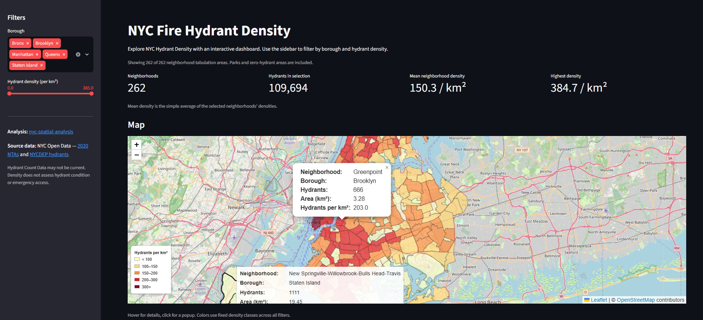
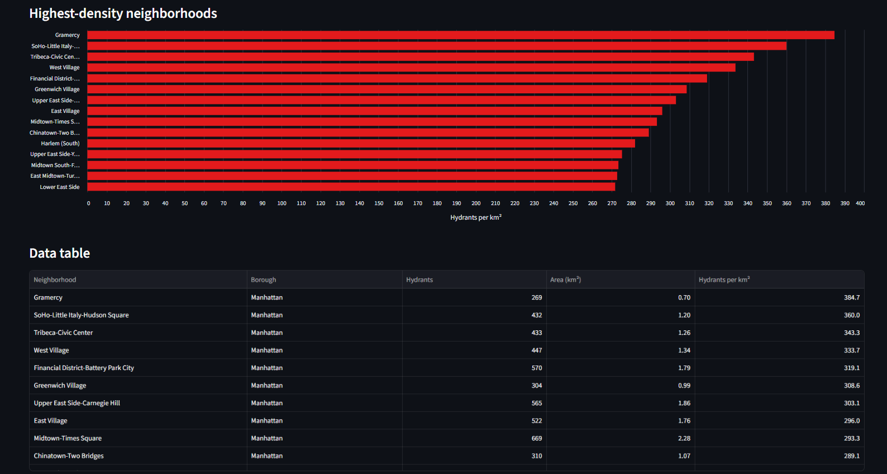

# NYC Fire Hydrant Density - Streamlit Deployment
Streamlit Deployment of analysis results in nyc-spatial-analysis. The dashboard offers a map, filters, charts and a table.

[view Streamlit deployment](https://share.streamlit.io/new)




## Data
The dataset covers all 262 NYC neighborhood tabulation areas from my `nyc-spatial-analysis` project. I copied the output from the analysis repo into nyc-streamlit-deployment

| Field | Description |
|---|---|
| `nta2020` | Neighborhood identifier |
| `ntaname` | Neighborhood name |
| `boroname` | Borough name |
| `hydrant_count` | Number of hydrants in the neighborhood |
| `area_km2` | Neighborhood area in square kilometers |
| `density_per_km2` | Hydrant density per square kilometer |


## Workflow
- Install the packages listed in `requirements.txt` 
- Copy `hydrant_density.parquet` in  folder
- Prompt GPT to generate code in app.py while using own descriptions and styling.
- Test locally and deploy through Streamlit Community Cloud


## Deployment
### Run locally
Requires Python 3.12. Run the commands from the project folder.
```bash
python3 -m venv .venv
source .venv/bin/activate
python -m pip install -r requirements.txt
python -m streamlit run app.py
```
### Hosted dashboard 
Hosted on Streamlit community platform: [Streamlit Deployment](https://share.streamlit.io/new/)

## Results / Visualizations
The map displays NYC neighborhoods colored by hydrant density. Hovering or clicking opens a popup with details. A borough filter and Hydrant density slider on the left pane offer further options to interact with the webmap as opposed to nyc-hydrant-map deployment.

## Project Files
| File | Purpose |
|---|---|
| `hydrant_density.parquet` | columnar file storing analysis results and geometries storing information which is showed in app |
| `app.py` | source code used by streamlit to run app in web |
| `requirements.txt` | Stores all the requirements for running streamlit app |

## What I learned
Modern GPT Models are very good at writing code. Using AI to build `app.py` once again showed that writing single lines of code is best outsourced to an agent, while the user should still administrate and orchestrate all systems / agents for useful decision making - or in this case: simply create a presentable repo. 

Streamlit is a open source framework for displaying python apps on the web. It helped me present the analysis results in a dashboard view with filters, charts, tables and a map.